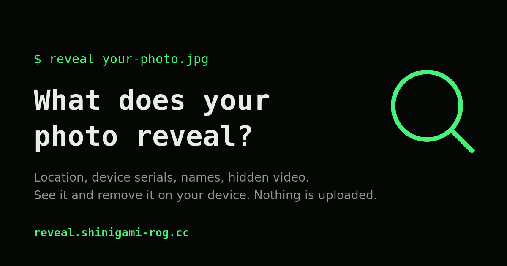

# safe-upload · reveal

[](https://www.npmjs.com/package/safe-upload)
[](https://github.com/sivaguru94/safe-upload/actions/workflows/ci.yml)
[](LICENSE)

**What does your photo reveal?** Where it was taken, when, on which phone, who is in it, an uncropped preview, a
hidden video. This repository contains a library that finds and removes that data on the user's device, and a
website that puts it in anyone's hands.

[](https://reveal.shinigami-rog.cc)

| | |
|---|---|
| **[`safe-upload`](packages/safe-upload)** | Zero-dependency TypeScript library: inspect and losslessly strip metadata from JPEG, PNG, WebP, HEIC and AVIF; optional on-device face redaction. Published on npm as [`safe-upload`](https://www.npmjs.com/package/safe-upload). |
| **[reveal](https://reveal.shinigami-rog.cc)** ([`site`](site)) | Drop a photo, see what it reveals, choose what to remove, hide faces, download a clean copy. Runs entirely in the browser; a strict Content-Security-Policy prevents it from sending data anywhere. |

## Repository layout

```
packages/safe-upload/   the npm library (source, unit tests)
site/                   reveal, a Vite single-page app built on the library
e2e/                    Playwright tests for the site
fixtures/               generated test photos (scripts/make-fixtures.sh)
deploy/                 nginx and Docker Compose configuration for the site
scripts/                build, fixture, e2e and deploy helpers
```

## Development

Requirements: Node.js ≥ 20.19, plus [exiftool](https://exiftool.org) and ImageMagick 7 for the unit tests, and
Docker for the end-to-end tests.

```bash
npm install
npm run build          # library, then site
npm test               # unit tests with exiftool and ImageMagick oracles
npm run e2e            # Playwright in Docker: Chromium, Firefox, WebKit, mobile
npm run dev -w site    # local development server
```

Test photos in `fixtures/` are synthetic and generated by `scripts/make-fixtures.sh` (ImageMagick, exiftool,
libheif). They contain no real personal data.

## Releases

Releases are published to npm by GitHub Actions ([`publish.yml`](.github/workflows/publish.yml)) when a `vX.Y.Z`
tag is pushed. The workflow runs the type check and the test suite, verifies that the tag matches the package
version, and publishes through npm trusted publishing with a signed
[provenance statement](https://docs.npmjs.com/generating-provenance-statements), so every version can be traced to
the commit and workflow that built it.

## Deployment

The site is served by a read-only, unprivileged nginx container and reached through a Cloudflare Tunnel; no inbound
port is opened. It keeps no access log. See [deploy/README.md](deploy/README.md).

## Contributing

Issues and pull requests are welcome. If a photo is handled incorrectly, a sample file is the most useful report;
please remove anything personal from it first.

## License

[MIT](LICENSE) © [Sivaguru Ravi](https://shinigami-rog.cc/sivaguru-ravi). Third-party data and models are listed in
[NOTICE.md](NOTICE.md).
